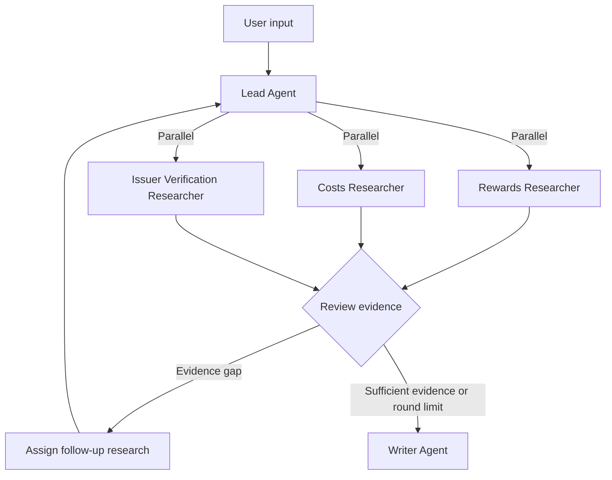

# CardWise: Personalized Credit Card Deep Research

CardWise is a multi-agent research project that compares credit cards for a user's spending, repayment habits, and preferences. It combines structured credit card data with issuer terms to explain how rewards, fees, and restrictions affect a recommendation.

## 1. Data Sources

| Source | Access | Use |
|---|---|---|
| **67.CREDIT** | [CSV and JSON downloads](https://67.credit/data) | Card details, rewards rates, points, annual fees, APRs, and welcome offers |
| **CFPB TCCP** | [Official dataset](https://www.consumerfinance.gov/data-research/credit-card-data/terms-credit-card-plans-survey/) | Historical credit card APRs, annual fees, and other fees reported in the Terms of Credit Card Plans survey |
| **American Express** | Product pages and cardmember agreements | Rewards rules, fees, and restrictions, with an option to check specific topics on the live product page |

### Local Researcher Data

- `data/research_cards.json` contains 67.CREDIT rewards snapshots for two Amex cards and terms from Amex product pages and cardmember agreements. The [67.CREDIT card dataset](https://67.credit/data) is attributed under [CC BY 4.0](https://creativecommons.org/licenses/by/4.0/).
- `data/cfpb_tccp-data_2025-12-31.csv` contains rows 34 and 35 from the `TCCP Survey` sheet of the [original CFPB workbook](https://files.consumerfinance.gov/f/documents/cfpb_tccp-data_2025-12-31.xlsx). It includes product names, reporting dates, annual fees, standard and promotional APRs, grace periods, and other fees. Rates stored as decimals in Excel are converted to percentages. Blank annual fee fields and reported zero values are preserved.

CFPB survey figures describe a historical reporting period. Card names may differ across sources. Use the issuer's official site to verify current terms.

### Run the Researchers Locally

```bash
python3 researchers.py --monthly-grocery 800
python3 researchers.py --monthly-grocery 200 --monthly-spend gas=700 --monthly-spend online_retail=800
python3 researchers.py --monthly-grocery 200 --monthly-spend gas=700 --monthly-spend online_retail=800 --monthly-spend transit=500
python3 researchers.py --monthly-grocery 800 --average-purchase-balance 1000 --annual-foreign-spend 1000 --balance-transfer 100
python3 -m unittest discover -s tests -v
```

These commands run the researchers' data tools without model credentials. The table estimates net cash back for one full calendar year after the first year, using the ongoing annual fee and assuming the statement balance is paid in full. Assign each eligible purchase to one category. Optional cost scenarios appear separately in the output. Supported categories are `grocery`, `gas`, `online_retail`, `transit`, `streaming`, and `other`. Use `streaming` for eligible subscriptions from select U.S. providers under the Preferred card's terms.

| Eligible monthly spending | Blue Cash Preferred | Blue Cash Everyday |
|---|---:|---:|
| $800 on groceries | $301 | $216 |
| $200 on groceries, $700 on gas, and $800 on online retail | $397 | $492 |
| Same spending plus $500 on eligible transit | $577 | $552 |

| Researcher | Data tools |
|---|---|
| Rewards | `lookup_rewards` returns catalog rates and dated welcome offers. Given planned eligible spending within the offer window, `check_welcome_offer` calculates how much more spending is needed to meet the threshold. |
| Costs | `lookup_costs` separates standard purchase, promotional purchase, and balance transfer APRs. `model_historical_costs` uses the supplied average interest-bearing purchase balance, foreign spending, and one-time balance transfer to estimate costs at the historical minimum, median, and maximum APRs. It itemizes interest and fees. The ongoing cash-back calculation deducts the annual fee separately. |
| Issuer Verification | `lookup_issuer_terms` retrieves terms from the product page or cardmember agreement snapshot. `check_merchant` checks merchant-category exclusions. `refresh_product_page` retrieves a short excerpt on a requested topic from the live Amex product page and records the retrieval time. It reports an evidence gap when the page is unavailable or lacks the relevant terms. |

Use `build_researcher_agents(model, model_settings)` to create the three OpenAI Agents SDK agents, and call each with `run_researcher(agent, card_ids, task, hooks=hooks)`. Supported IDs are listed in `researchers.CARD_IDS`. Each call starts with a fresh context and returns a model summary, structured `findings`, `unresearched_card_ids`, and Project 1–style `tool_calls` with an `agent` field. The Lead can run these calls concurrently and combine the traces.

With Vertex AI credentials configured for the project, use this example to test the three agents' model calls independently of the Lead.

```bash
uv run python - <<'PY'
import asyncio

from app import RESEARCHER_MODEL, SETTINGS
from researchers import CARD_IDS, build_researcher_agents, run_researcher

async def demo():
    agents = build_researcher_agents(RESEARCHER_MODEL, SETTINGS)
    results = await asyncio.gather(*(
        run_researcher(agent, list(CARD_IDS), "Compare the two cards on your assigned evidence.")
        for agent in agents.values()
    ))
    for result in results:
        print(result["agent"], len(result["tool_calls"]), result["unresearched_card_ids"])
        print(result["summary"])

asyncio.run(demo())
PY
```

Use `estimate_spending_rewards(card_id, monthly_spend, issuer_evidence)` for a multi-category estimate or `estimate_annual_grocery_rewards` for a grocery-only estimate. Pass structured evidence from Issuer Verification's `findings[*].evidence`. Request `product` for rates and spending caps, then `terms` for reset periods and exclusions. The Lead can compare live excerpts with the structured evidence and report discrepancies. The calculator uses structured issuer evidence for its inputs. Offer eligibility, personal APR, and merchant coding for a specific transaction require separate confirmation.

## 2. Research Questions

### EP1 — Credit Card Rewards

**Which cards could earn the most rewards given the user's spending habits?**

Compare cash-back rates, points, and welcome offers across categories such as dining, groceries, travel, and online shopping. Use the user's spending mix to estimate potential rewards.

### EP2 — Credit Card Costs

**How do annual fees, APRs, and other charges affect a card's net value?**

Compare the costs of holding different cards under different repayment scenarios.

### EP3 — Issuer Terms and Restrictions

**Are the advertised rewards and fees still current? Which restrictions could affect the value a user receives?**

Consult official issuer sources to verify rewards rules, spending caps, eligible categories, offer periods, and published eligibility terms.

### Combined Research Question

**Which card best fits the user after accounting for rewards, costs, and restrictions? How might the recommendation change with different spending or repayment habits?**

## 3. Agent Architecture

The diagram shows the intended end-to-end workflow. The three CardWise researchers can currently be run on their own using the commands above.



| Agent | Responsibilities |
|---|---|
| **Lead Agent** | Clarify the user's needs, shortlist cards, assign parallel research tasks, evaluate the evidence, and manage up to three research rounds. |
| **Rewards Researcher** | Use 67.CREDIT to investigate rates, points, eligible spending categories, and welcome offers. |
| **Costs Researcher** | Use CFPB TCCP data to investigate annual fees, APRs, other fees, and potential cardholder costs. |
| **Issuer Verification Researcher** | Consult Amex product pages and cardmember agreements. Follow up on specific terms and merchant restrictions as needed. |
| **Writer Agent** | Summarize the findings in a cited report with a rewards comparison, recommendation rationale, and relevant risks. |

## 4. Example Research Workflow

### User Question

> I spend about $800 per month on groceries and want a card that earns more cash back on those purchases. Which is a better fit, Amex Blue Cash Preferred or Blue Cash Everyday?

### Round 1 — Parallel Research

The Lead assigns three tasks in parallel.

- **Rewards** compares the two cards' grocery cash-back rates using 67.CREDIT.
- **Costs** looks up annual fees, APRs, and other fees in the CFPB data.
- **Issuer Verification** reviews the Amex product pages and can request the live page when current terms need verification.

### Evidence Gap

If the first round leaves the annual grocery caps or the rates above those caps unverified, the Lead identifies those terms as a follow-up. At approximately $9,600 in annual grocery spending, the caps can materially affect the cash-back estimates.

### Round 2 — Targeted Follow-Up

- **Issuer Verification** consults the official American Express rewards terms to confirm the calendar-year caps and the rates that apply above them.
- **Lead** uses the verified terms to recalculate annual cash back, subtract the applicable annual fees, and reassess the recommendation.

The Lead can request further research if a remaining gap could change the conclusion, up to a total of three rounds. If the first round verifies the material terms, the Lead can proceed directly to the report.

### Final Report

The Writer produces a cited recommendation that includes:

- Estimated annual cash back after applying rewards caps.
- Annual fees and potential interest costs.
- A comparison of the two cards' net value.
- The rationale for the recommendation and the conditions that could change it.
- References to 67.CREDIT, CFPB, and the issuer.

## 5. Implementation Plan

The project uses Python, the OpenAI Agents SDK, Gemini through Vertex AI and LiteLLM, HTTPX, FastAPI, and a web frontend.

1. **Collect inputs.** The Lead gathers spending categories and amounts, repayment habits, and annual fee preferences. It asks for clarification when a necessary detail is missing.
2. **Shortlist cards.** Use 67.CREDIT to identify two to four candidates that fit the user's needs. The current researcher dataset covers two Amex cards.
3. **Run parallel research.** The Lead launches the three researchers concurrently, each with its own context.
4. **Review evidence.** The Lead checks for missing information, conflicting data, and restrictions that could affect the recommendation.
5. **Follow up where needed.** The Lead assigns targeted tasks for material evidence gaps, up to three rounds.
6. **Calculate net value.** Python calculates annual rewards, fees, and applicable interest scenarios.
7. **Write the report.** The Writer summarizes the findings in Markdown and includes source links, assumptions, and uncertainties.
8. **Present the results.** FastAPI and the web frontend present the research process and final recommendation.

The language model handles research planning, evidence interpretation, and synthesis. Python handles data lookups, calculations, and orchestration.

## 6. Team Responsibilities

| Team member | Responsibilities |
|---|---|
| **Serena** | Lead Agent and orchestration, including research planning, agent scheduling, and follow-up rounds |
| **Xunzhi** | Researcher Agents for rewards, costs, and issuer verification |
| **Haoxi** | Writer Agent, frontend, and deployment, including report generation and the user interface |
