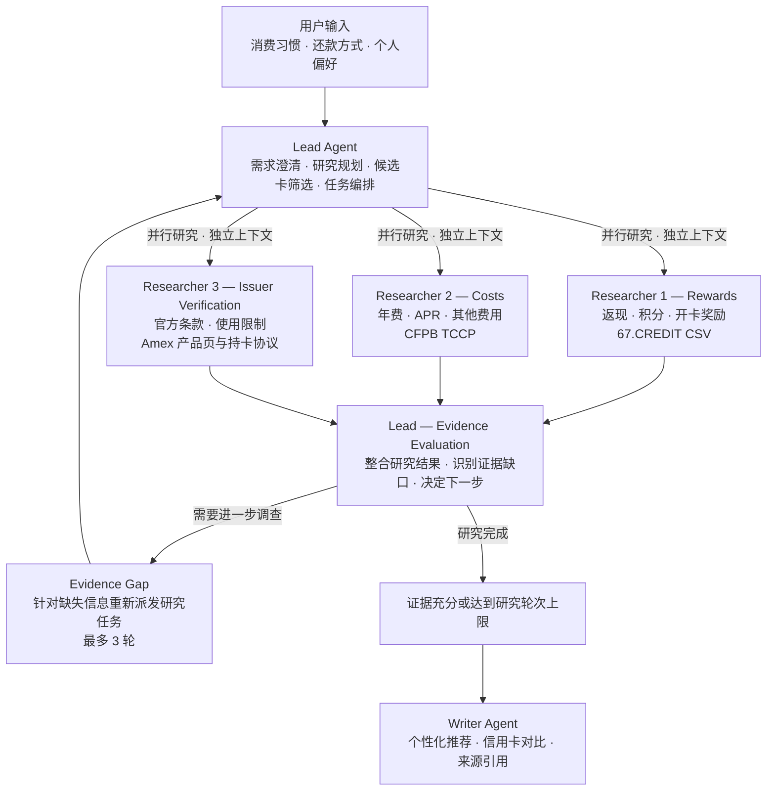

# CardWise — 个性化信用卡 Deep Research 系统

CardWise 是一个基于多 Agent 的 Deep Research 系统，根据用户的消费习惯、还款方式和个人偏好，结合结构化信用卡数据与发卡行官方条款，分析信用卡的奖励收益、持卡成本和使用限制，提供有证据支持的个性化推荐。

## 1. 数据集与数据来源

| 数据源 | 下载 / 访问链接 | 用途 |
|---|---|---|
| **67.CREDIT** | [下载 CSV / JSON](https://67.credit/data) | 信用卡基础信息、返现倍率、积分、年费、APR、开卡奖励 |
| **CFPB TCCP** | [官方数据集](https://www.consumerfinance.gov/data-research/credit-card-data/terms-credit-card-plans-survey/) | 官方报告的信用卡 APR、年费及其他费用 |
| **银行官方网站** | Amex 产品页与持卡协议 | 奖励规则、费用和使用限制。支持按主题请求实时核验 |

**Researcher MVP 数据文件**

- `data/research_cards.json` 收录两张 Amex 卡的 67.CREDIT 奖励快照，以及 Amex 产品页和持卡协议中的条款。67.CREDIT 来源按 [CC BY 4.0](https://creativecommons.org/licenses/by/4.0/) 署名，见 [67.CREDIT card dataset](https://67.credit/data)。
- `data/cfpb_tccp-data_2025-12-31.csv` 来自 [CFPB 原始工作簿](https://files.consumerfinance.gov/f/documents/cfpb_tccp-data_2025-12-31.xlsx) 的 `TCCP Survey` 第 34、35 行。提取产品、报告日期、年费、常规与促销 APR、宽限期和手续费列。将 Excel 中的利率小数转换为百分数，保留空白年费和真实的零值。

CFPB 数据并非实时数据，且两个数据集中的信用卡名称可能存在差异。当前条款优先以银行官方网站为准。

### Researcher 本地运行

```bash
python3 researchers.py --monthly-grocery 800
python3 researchers.py --monthly-grocery 200 --monthly-spend gas=700 --monthly-spend online_retail=800
python3 researchers.py --monthly-grocery 200 --monthly-spend gas=700 --monthly-spend online_retail=800 --monthly-spend transit=500
python3 researchers.py --monthly-grocery 800 --average-purchase-balance 1000 --annual-foreign-spend 1000 --balance-transfer 100
python3 -m unittest discover -s tests -v
```

本地命令直接运行三个 Researcher 的数据工具，无需模型凭据。返现表按一个完整日历年的续年费用、全额还款和互不重叠的合格消费类别计算。可选费用情景在输出中单列。支持类别为 `grocery`、`gas`、`online_retail`、`transit`、`streaming` 和 `other`。其中 `streaming` 输入代表符合 Preferred 条款的指定美国订阅。

| 每月消费 | Blue Cash Preferred | Blue Cash Everyday |
|---|---:|---:|
| $800 超市 | $301 | $216 |
| $200 超市、$700 加油、$800 网购 | $397 | $492 |
| 上一组消费加 $500 合格通勤 | $577 | $552 |

| Agent | 数据工具 |
|---|---|
| Rewards | `lookup_rewards` 返回目录费率和带日期的开卡奖励。给定优惠窗口内的计划消费额时，`check_welcome_offer` 计算还差多少达标。 |
| Costs | `lookup_costs` 区分常规、开卡促销和余额转移 APR。`model_historical_costs` 用指定的平均计息余额、外币消费和一次余额转移金额计算历史低、中、高 APR 情景。结果含利息与手续费明细，年费由续年返现计算扣除。 |
| Issuer Verification | `lookup_issuer_terms` 可按产品页或持卡协议补查。`check_merchant` 核查商户类型的排除规则。`refresh_product_page` 可按主题读取 Amex 官方产品页，返回抓取时间和短摘录，页面不可达或缺乏对应条款时返回缺口。 |

实际 Agent 接入使用 `build_researcher_agents(model, model_settings)` 构造三个 Agents SDK Agent，分别以 `run_researcher(agent, card_ids, task, hooks=hooks)` 调用。支持的 ID 见 `researchers.CARD_IDS`。每次调用创建独立上下文，返回模型摘要、结构化 `findings`、`unresearched_card_ids` 和带 `agent` 的 Project 1 格式 `tool_calls`。Lead 可并行启动这些调用，并把各自的 `tool_calls` 合并。

已有项目的 Vertex AI 凭据时，可在终端单独验证三个 Agent 的模型调用。

```bash
uv run python - <<'PY'
import asyncio

from app import RESEARCHER_MODEL, SETTINGS
from researchers import CARD_IDS, build_researcher_agents, run_researcher

async def demo():
    agents = build_researcher_agents(RESEARCHER_MODEL, SETTINGS)
    results = await asyncio.gather(*(
        run_researcher(agent, list(CARD_IDS), "Compare the two cards on your assigned evidence.")
        for agent in agents.values()
    ))
    for result in results:
        print(result["agent"], len(result["tool_calls"]), result["unresearched_card_ids"])
        print(result["summary"])

asyncio.run(demo())
PY
```

多类别计算使用 `estimate_spending_rewards(card_id, monthly_spend, issuer_evidence)`。原超市接口 `estimate_annual_grocery_rewards` 仍可调用。传入 Issuer Verification 的 `findings[*].evidence`，用 `product` 查费率和金额上限，再用 `terms` 补查重置周期和排除项。计算器要求结构化的 issuer 证据。实时网页摘录供 Lead 对照并报告差异，未确认的文本不会直接改变计算参数。优惠资格、个人 APR 和具体交易的商户编码都需单独确认。

## 2. Exploration Problems（研究问题）

### EP1 — 信用卡奖励收益分析

**根据用户的消费习惯，哪些信用卡能够提供最高的潜在奖励收益？**

分析不同信用卡在餐饮、超市、旅行、网购等类别的返现比例、积分和开卡奖励，并根据用户消费结构估算潜在收益。

### EP2 — 信用卡费用与成本分析

**年费、APR 和其他费用如何影响信用卡的实际价值？**

研究不同信用卡的年费、利率及其他手续费，并分析不同还款习惯下的潜在持卡成本。

### EP3 — 官方条款与限制核验

**信用卡宣传的奖励和费用是否仍然有效？实际使用中有哪些限制可能影响收益？**

通过银行官方网站核验当前奖励规则、消费上限、适用消费类别、优惠有效期和申请资格。

### Combined Exploration Problem（综合研究问题）

**综合奖励收益、持卡成本和实际使用限制，哪张信用卡最适合用户？在不同消费与还款情景下，最终推荐是否会发生变化？**

## 3. Agent Architecture（多 Agent 架构）



### Agent 职责

| Agent | 具体职责 |
|---|---|
| **Lead Agent** | 理解用户需求，筛选候选信用卡，并行分配研究任务，判断证据是否充分，并控制多轮研究 |
| **Researcher 1 — Rewards** | 使用 67.CREDIT 分析信用卡奖励倍率、积分、消费类别及开卡奖励 |
| **Researcher 2 — Costs** | 使用 CFPB TCCP 研究年费、APR、手续费和潜在持卡成本 |
| **Researcher 3 — Issuer Verification** | 查阅 Amex 产品页与持卡协议，按任务补查官网条款和商户限制 |
| **Writer Agent** | 汇总研究结果，生成包含收益对比、推荐理由、风险说明和准确引用的报告 |

## 4. Deep Research 场景示例

### 用户问题

> 我每个月超市消费大约 $800，希望选择一张超市返现较高的信用卡。Amex Blue Cash Preferred 和 Blue Cash Everyday 哪张更适合我？

### Round 1 — 初步并行研究

Lead 同时派发三个研究任务：

- **R1（Rewards）：** 使用 67.CREDIT 比较两张卡的超市返现倍率。
- **R2（Costs）：** 使用 CFPB 数据查询年费、APR 和其他费用。
- **R3（Issuer）：** 查阅 Amex 产品页的奖励和费用规则，需要确认时效时重新请求官网。

### Evidence Gap — 发现证据缺口

67.CREDIT 提供超市返现倍率，但没有完整记录奖励上限。

假设 R3 在第一轮也没有确认上限，Lead 就会发现：

**“这两张信用卡的超市返现是否存在年度消费上限？这个限制是否会改变最终的推荐结果？”**

由于用户每年超市消费约 $9,600，奖励上限可能影响实际收益，因此需要进一步调查。

### Round 2 — 针对性追加研究

- **R3：** 搜索 American Express 官方 Rewards Terms，确认年度消费上限以及超过上限后的返现倍率。
- **Lead：** 收集核验结果后，调用简单计算工具重新估算两张卡的年度奖励，并扣除适用年费。

Lead 根据新的研究结果重新评估推荐。

如果仍然存在可能影响结论的重要信息缺口，可以继续追加研究，最多 3 轮。

如果第一轮已经核实所有重要条款，则不需要强制执行第二轮。

### Final Report — 最终报告

Writer 生成带来源引用的信用卡推荐报告，包括：

- 考虑奖励上限后的年度返现估算
- 年费与潜在利息成本
- 两张信用卡的实际收益比较
- 推荐理由及可能改变推荐的条件
- 67.CREDIT、CFPB 和银行官网的来源引用

**Deep Research 核心：** Lead 根据第一轮研究结果主动发现重要信息缺口，并决定是否进行下一轮调查，而不是固定执行所有研究步骤。

## 5. 具体实现

**技术栈：** Python、OpenAI Agents SDK、Gemini（Vertex AI + LiteLLM）、HTTPX、FastAPI、Web Frontend。

1. **用户输入与澄清：** 收集消费类别、消费金额、还款习惯和年费偏好。缺少必要信息时由 Lead 询问。
2. **候选卡筛选：** 使用 67.CREDIT 数据筛选 2–4 张适合用户的信用卡。
3. **并行研究：** Lead 同时启动三个 Researcher，每个 Researcher 使用独立上下文。
4. **证据评估：** Lead 汇总研究结果，检查信息缺失、数据冲突及可能影响推荐的限制条件。
5. **多轮研究：** 若存在重要 Evidence Gap，Lead 重新派发针对性任务，最多进行 3 轮。
6. **收益计算：** 使用简单 Python 函数计算年度奖励、年费及适用的利息情景，避免 LLM 直接进行复杂数值计算。
7. **报告生成：** Writer 将研究结果整合为 Markdown 报告，附上来源链接、适用条件和不确定性说明。
8. **前端与部署：** 使用 FastAPI 和 Web Frontend 展示 Agent 研究过程及最终推荐报告。

**实现原则：** 以 LLM 负责研究规划、信息理解、证据核验和综合推理；Python 主要用于数据查询、简单计算及 Agent 编排。

## 6. 团队分工

| 成员 | 负责内容 |
|---|---|
| **Serena** | Lead Agent + Orchestration（研究规划、多 Agent 调度、多轮研究控制） |
| **Xunzhi** | Researcher Agents（Rewards、Costs、Web Verification） |
| **Haoxi** | Writer Agent + Frontend + Deployment（报告生成、前端开发、部署） |
