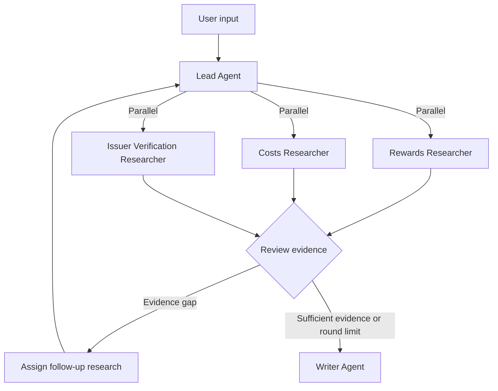

# CardWise: Personalized Credit Card Deep Research

CardWise is a multi-agent research project that compares credit cards for a user's spending, repayment habits, and preferences. It combines structured credit card data with issuer terms to explain how rewards, fees, and restrictions affect a recommendation.

## 1. Data Sources and Researcher Coverage

The default inventory is the complete downloaded catalog and survey. The checked-in snapshots contain **201 catalog cards** and **663 CFPB product records**. Source dates and download hashes are recorded in `data/research_sources.json`.

| Source | Local files | Use |
|---|---|---|
| [67.CREDIT](https://67.credit/data) | `data/cards_67credit.json` | Discover cards across issuers, inspect availability, fees, rewards rates, notes, point values, and dated welcome offers. Attribution is under [CC BY 4.0](https://creativecommons.org/licenses/by/4.0/). |
| [CFPB TCCP](https://www.consumerfinance.gov/data-research/credit-card-data/terms-credit-card-plans-survey/) | `data/cfpb_tccp_2025-12-31.xlsx` and `data/cfpb_tccp_2025-12-31.csv` | Search all reported products and match historical APRs, fees, promotional rates, and reporting periods to catalog candidates. The CSV preserves every original column, converts fractional percentage values to percent units, and normalizes line endings and trailing whitespace in text. The workbook retains the original source values. |
| Official issuer websites | Gemini Google Search grounding, called at research time | Discover product pages and terms for the supplied card name and issuer. Each accepted claim retains the official source URL, retrieval time, and grounding citation. |

The earlier two-card snapshots in `data/research_cards.json` and `data/cfpb_tccp-data_2025-12-31.csv` support reproducible examples and regression tests. They are separate from the default full inventory. Missing catalog rates, unavailable products, uncertain survey matches, and missing official evidence are reported explicitly.

### Run Local Discovery

```bash
uv sync
uv run python -m scripts.researchers --monthly-grocery 800 --monthly-spend dining=300 --limit 5
uv run python -m scripts.researchers --cards chase-freedom-unlimited wf-active-cash --monthly-spend dining=300 --monthly-spend other=500
uv run python -m unittest discover -s tests -v
```

Without `--cards`, the command screens the full catalog for candidates. Screening uses the catalog's baseline point value and excludes inactive products and business cards by default. Its estimated values omit caps, credits, activation requirements, and bonuses. Review the rewards notes and verify official terms before using those values for a final comparison. Cards lacking typed rates remain searchable and are identified as unscored.

Supported spending categories are `grocery`, `dining`, `travel`, `gas`, `online_retail`, `transit`, `streaming`, and `other`. The catalog lacks a separate transit rate, so screening uses its `other` rate for transit and states that assumption.

### Run All Three Researchers with Gemini

Configure the same Vertex AI application credentials used for the course project, then run a multi-card research task.

```bash
export GOOGLE_CLOUD_PROJECT=your-gcp-project
export GOOGLE_CLOUD_LOCATION=global
export CARDWISE_LEAD_MODEL=vertex_ai/gemini-3.5-flash
export CARDWISE_LEAD_FALLBACK_MODEL=vertex_ai/gemini-3.5-flash-lite
export CARDWISE_RESEARCH_MODEL=vertex_ai/gemini-3.5-flash-lite
export CARDWISE_WRITER_MODEL=vertex_ai/gemini-3.5-flash
export CARDWISE_SEARCH_MODEL=gemini-3.5-flash-lite
uv run python -m scripts.researchers --cards chase-freedom-unlimited wf-active-cash --monthly-spend dining=300 --monthly-spend other=500 --research
```

The standalone demo starts the three researchers concurrently in fresh contexts. The Lead defaults to `vertex_ai/gemini-3.5-flash` and falls back to `vertex_ai/gemini-3.5-flash-lite` only when Vertex returns a capacity-related 429. Researchers default to flash-lite, and the Writer defaults to flash. `CARDWISE_LEAD_MODEL`, `CARDWISE_LEAD_FALLBACK_MODEL`, `CARDWISE_RESEARCH_MODEL`, and `CARDWISE_WRITER_MODEL` override them independently. `CARDWISE_SEARCH_MODEL` controls the separate Google GenAI request that enables Google Search. Search and function calling run in separate requests.

| Researcher | Tools and behavior |
|---|---|
| Rewards | `discover_cards` searches the full catalog. `screen_spending` proposes candidates for a spending profile. `lookup_rewards` returns rates, rewards notes, and dated bonuses. `check_welcome_offer` reports missing qualification terms when the catalog lacks them. |
| Costs | `lookup_costs` matches a catalog card using issuer aliases and the normalized product name. A unique exact match supplies historical evidence. Ambiguous matches and fuzzy suggestions remain unverified. `search_survey` searches every CFPB product directly. `model_historical_costs` estimates interest and fees from explicit scenario inputs. |
| Issuer Verification | `search_official_terms` discovers issuer pages using Google Search. It accepts only answer segments with grounding citations to the issuer's domains. `calculate_verified_rewards` calculates cash back from normalized rules, each referencing a grounded claim from the same research context; it rejects a normalized field or value that is not semantically supported by that claim. Lead completion checks required issuer fields separately for every researched card. Missing fees, rates, caps, reset periods, or other necessary fields require follow-up. |

`issuer_search.py` stores issuer domains for source validation, while product-page URLs are discovered at runtime. Google citation redirects are resolved to identify the source domain. Unsupported sources and ungrounded text remain outside the verified evidence. Google Search suggestions are preserved in `search_entry_point_html` for the frontend to present according to the [grounding documentation](https://cloud.google.com/vertex-ai/generative-ai/docs/grounding/grounding-with-google-search).

The candidate screening stage and the official verification stage serve different decisions. The Lead can request more research when a cap, eligibility condition, outdated figure, or product mismatch could change the result. CFPB data is historical. Published terms do not determine personal approval, a personal APR, or the merchant code assigned to a particular transaction. Rewards calculations assume a full calendar year of eligible spending and full statement payment.

### Integrate with the Lead

`scripts/lead.py` implements the end-to-end Lead → Researchers → Writer workflow. The Lead resolves explicitly named cards itself; for an open-market recommendation it asks the Rewards Researcher to screen up to four candidates in a separate discovery phase. Successful discovery can run only once. Formal research rounds execute in order from one through three: a round cannot be skipped, revisited, or started while an earlier round still has active work. A failed Researcher invocation is retried once. Code caps each run at ten actual Researcher calls, including retries and discovery, and rejects identical repeated assignments while allowing one Researcher to handle multiple distinct tasks in the same round. Before returning `RESEARCH_COMPLETE`, the Lead saves a concise Research Assessment with verified facts, resolved conflicts, and unresolved gaps. Every verified fact is a structured `{statement, evidence_ids}` record and must cite at least one evidence ID actually collected during the run. The Writer runs only when both the assessment and exact completion signal are present, and receives the assessment alongside the full structured evidence.

Agent modules live together under `scripts/`: `lead.py` owns orchestration, `researchers.py` owns the three evidence-gathering agents and their tools, and `writer.py` owns final synthesis. The root `app.py` only provides the FastAPI and Server-Sent Events web layer.

Live Issuer agents expose a single extraction/calculation path: `search_official_terms` → `register_issuer_terms` → `calculate_from_terms`. Legacy normalization and calculation tools are available only with explicit `build_researcher_agents(..., legacy_tools=True)` for compatibility tests, not the default application. Cards without local snapshots do not expose the snapshot fallback at runtime. Quote errors return the collected source text for correction without another search; exhausted fields instruct the researcher to stop retrying. Unchanged calculation inputs and registered terms reuse a cached result; newly registered terms allow recalculation. Lead rejects dispatches whose Researcher tool budget is already exhausted.

The preferred issuer workflow is `register_issuer_terms` → `calculate_from_terms`. The researcher interprets source quotes into fee, rate, and cap-status fields scoped to a category or explicitly to all purchases. Registration checks quote provenance, numeric consistency, scope boundaries, and bounded field repairs; model interpretation is retained as `verification_method: quoted_model_extraction`, not a guarantee of semantic correctness. The calculator consumes only registered terms relevant to nonzero spending. Missing terms preserve successful category results without publishing a verified net total. Explicit unknown-cap assumptions produce `conditional_estimate`, which Lead cannot treat as a verified estimate. Legacy rule-normalization/calculator tools remain for snapshot compatibility.

Researcher evidence is retained across follow-up rounds in a per-role trace. Each role has a run-wide budget of 24 tool attempts, with at most eight invocations of any individual tool; identical tool arguments are blocked before external work. Individual model-request retries remain in the model adapter. A Researcher execution error or turn limit returns partial evidence rather than restarting its completed steps. `normalize_issuer_rules` registers each supported field independently; a failed calculation retains accepted fields and identifies all invalid fields and matching collected claims. Issuer handoff summaries publish numeric reward calculations only from successful calculator records. Lead handoffs include current per-card coverage, calculation status, per-tool remaining capacity and terminal budget reasons; a later successful follow-up closes an earlier failed assignment. Assessment verified facts are rendered directly from their referenced evidence values, source types and dates. Machine-detected quality issues are retained separately from the model's concise-summary quota.

Call `deep_research(user_input, hooks=None)` or `cardwise_answer(query)` for the complete workflow. The Lead uses `build_researcher_agents(model, model_settings)` and `run_researcher(agent, card_ids, task, hooks=hooks)` internally. Each researcher call returns a summary, structured `findings`, `unresearched_card_ids`, and Project 1–style `tool_calls` with an `agent` field. `CARD_IDS` contains all catalog slugs. `EXAMPLE_CARD_IDS` identifies the two original Amex examples.

To run the web application:

```bash
uv run python app.py
```

`estimate_spending_rewards(card_id, monthly_spend, issuer_evidence)` accepts structured issuer snapshot or grounded evidence. The issuer agent supplies the ongoing annual fee, bonus categories, capped categories, category rates, cap amounts, reset periods, and rates above the caps. Each normalized field retains its supporting claim. The grocery-only calculator remains available for the original examples.

### Refresh the Complete Datasets

```bash
uv run python scripts/refresh_research_data.py
```

To reproduce the conversion from existing downloads, use `--catalog-file PATH` and `--cfpb-workbook PATH`. The refresh script retains the source JSON and workbook, exports all CFPB product rows, and updates the counts, URLs, hashes, and preparation timestamp in `data/research_sources.json`.

## 2. Research Questions

### EP1 — Credit Card Rewards

**Which cards could earn the most rewards given the user's spending habits?**

Compare cash-back rates, points, and welcome offers across categories such as dining, groceries, travel, and online shopping. Use the user's spending mix to estimate potential rewards.

### EP2 — Credit Card Costs

**How do annual fees, APRs, and other charges affect a card's net value?**

Compare the costs of holding different cards under different repayment scenarios.

### EP3 — Issuer Terms and Restrictions

**Are the advertised rewards and fees still current? Which restrictions could affect the value a user receives?**

Consult official issuer sources to verify rewards rules, spending caps, eligible categories, offer periods, and published eligibility terms.

### Combined Research Question

**Which card best fits the user after accounting for rewards, costs, and restrictions? How might the recommendation change with different spending or repayment habits?**

## 3. Agent Architecture

The diagram shows the implemented end-to-end workflow. The three CardWise researchers can also be run on their own using the commands above.



| Agent | Responsibilities |
|---|---|
| **Lead Agent** | Clarify the user's needs, shortlist cards, assign parallel research tasks, evaluate the evidence, and manage up to three research rounds. |
| **Rewards Researcher** | Search the complete 67.CREDIT catalog and screen candidates using rates, points, spending categories, and welcome offers. |
| **Costs Researcher** | Use CFPB TCCP data to investigate annual fees, APRs, other fees, and potential cardholder costs. |
| **Issuer Verification Researcher** | Discover official product pages and terms through grounded web search. Follow up on specific terms and merchant restrictions as needed. |
| **Writer Agent** | Summarize the findings in a cited report with a rewards comparison, recommendation rationale, and relevant risks. |

## 4. Example Research Workflow

### User Question

> I spend about $800 per month on groceries and want a card that earns more cash back on those purchases. Which is a better fit, Amex Blue Cash Preferred or Blue Cash Everyday?

### Round 1 — Parallel Research

The Lead assigns three tasks in parallel.

- **Rewards** compares the two cards' grocery cash-back rates using 67.CREDIT.
- **Costs** looks up annual fees, APRs, and other fees in the CFPB data.
- **Issuer Verification** searches for current Amex product pages and official rewards terms.

### Evidence Gap

If the first round leaves the annual grocery caps or the rates above those caps unverified, the Lead identifies those terms as a follow-up. At approximately $9,600 in annual grocery spending, the caps can materially affect the cash-back estimates.

### Round 2 — Targeted Follow-Up

- **Issuer Verification** consults the official American Express rewards terms to confirm the calendar-year caps and the rates that apply above them.
- **Lead** uses the verified terms to recalculate annual cash back, subtract the applicable annual fees, and reassess the recommendation.

The Lead can request further research if a remaining gap could change the conclusion, up to a total of three rounds. If the first round verifies the material terms, the Lead can proceed directly to the report.

### Final Report

The Writer produces a cited recommendation that includes:

- Estimated annual cash back after applying rewards caps.
- Annual fees and potential interest costs.
- A comparison of the two cards' net value.
- The rationale for the recommendation and the conditions that could change it.
- References to 67.CREDIT, CFPB, and the issuer.

## 5. Implementation Plan

The project uses Python, the OpenAI Agents SDK, Gemini through Vertex AI and LiteLLM, Google GenAI with Google Search grounding, HTTPX, FastAPI, and a web frontend.

1. **Collect inputs.** The Lead gathers spending categories and amounts, repayment habits, and annual fee preferences. It asks for clarification when a necessary detail is missing.
2. **Shortlist cards.** Use 67.CREDIT to identify two to four candidates that fit the user's needs. The researcher inventory contains all cards from the downloaded catalog.
3. **Run parallel research.** The Lead launches the three researchers concurrently, each with its own context.
4. **Review evidence.** The Lead checks for missing information, conflicting data, and restrictions that could affect the recommendation.
5. **Follow up where needed.** The Lead assigns targeted tasks for material evidence gaps, up to three rounds.
6. **Calculate net value.** Python calculates annual rewards, fees, and applicable interest scenarios.
7. **Write the report.** The Writer summarizes the findings in Markdown and includes source links, assumptions, and uncertainties.
8. **Present the results.** FastAPI and the web frontend present the research process and final recommendation.

The language model handles research planning, evidence interpretation, and synthesis. Python handles data lookups, calculations, and orchestration.

## 6. Team Responsibilities

| Team member | Responsibilities |
|---|---|
| **Serena** | Lead Agent and orchestration, including research planning, agent scheduling, and follow-up rounds |
| **Xunzhi** | Researcher Agents for rewards, costs, and issuer verification |
| **Haoxi** | Writer Agent, frontend, and deployment, including report generation and the user interface |
